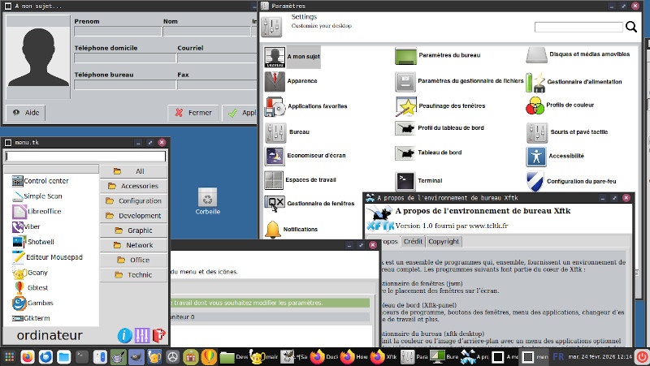
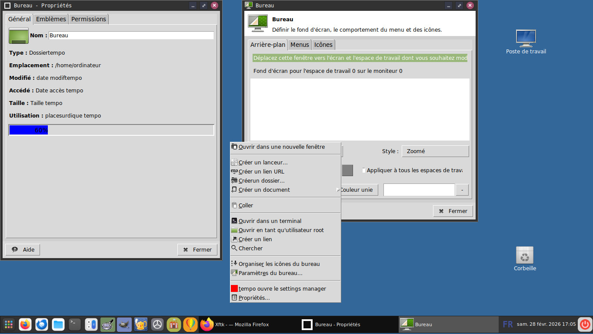
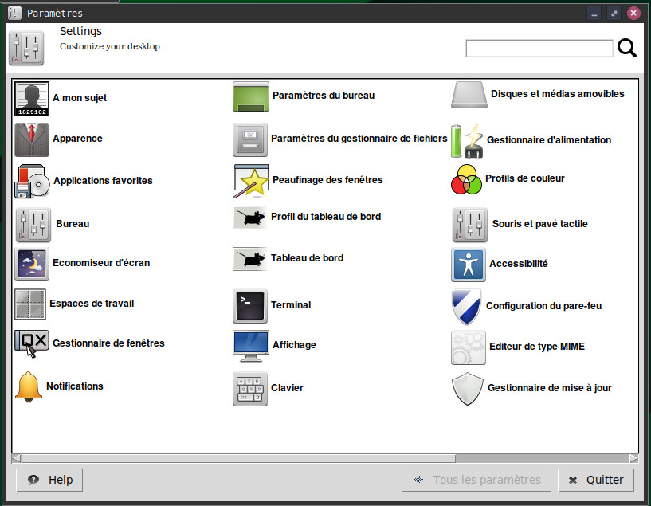
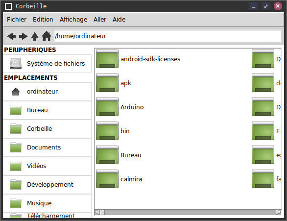
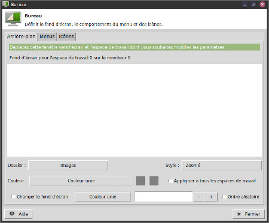
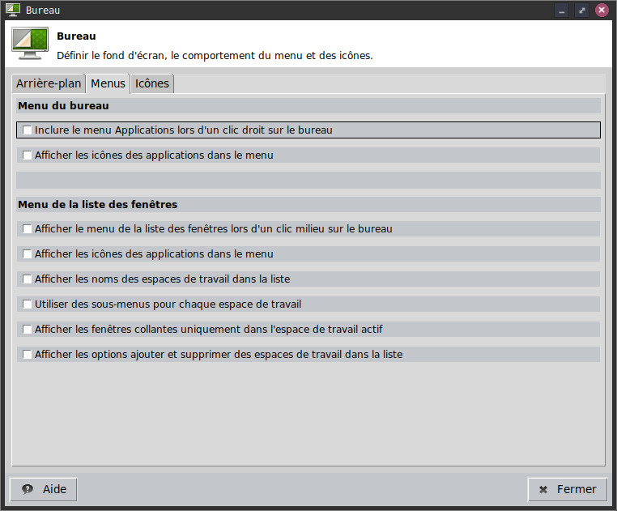

# xfcetk a XFCE desktop clone made in pure tcl tk language.

# Description
Xfcetk want to recreate xfce desktop with only tcl language tk library.
You have to install :
Tix library
sqlite3 tcl
and tk 8 minimum.

# Why this project ?
because i like xcfe desktop and because i do not like gtk or Qt libraries. Many versions, unstable, too heavy, and the main :
because tk is not die ! tcl tk 9.0 is here and a wonderfull library : incredible fast and small.

# Requirement
Linux computer with :
tcl 8.x
tk 8.x
tcl-sqlite
Tix

# Download last zip
[Direct link for last project (.zip)](https://github.com/FabienTon/xfcetk/archive/refs/heads/main.zip)

# How to run 
in command line :
wish main.tk

# What language ?
this project is developped in English on French locale computer. Sorry if some words are in French.

# License
Mit License means COMPLETLY FREE to use and redistribute.

# Screenshots

# Comments

French page of project. (more recent on github)

